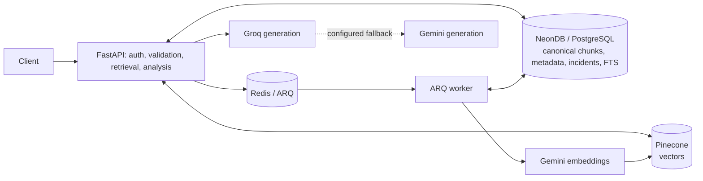

# IncidentIQ

IncidentIQ is an evidence-grounded incident investigation API. It indexes operational documents, retrieves relevant evidence, and returns hypotheses with citations and read-only diagnostic steps. It is a decision-support system; it does not execute production remediation.

## Architecture



### Request flow

```mermaid
sequenceDiagram
  participant C as Client
  participant A as FastAPI
  participant D as NeonDB
  participant Q as Redis / ARQ
  participant W as Worker
  participant G as Gemini embeddings
  participant P as Pinecone
  C->>A: Upload document (bearer token)
  A->>A: Validate type and size; extract and chunk
  A->>D: Persist canonical chunks and queued job
  A->>Q: Enqueue stable job ID
  W->>D: Read canonical chunks
  W->>G: Create embeddings
  W->>P: Upsert stable vector IDs
  W->>D: Mark ingestion complete
  C->>A: Search / analyze incident
  A->>P: Retrieve semantic candidates (when configured)
  A->>D: Full-text search and fetch canonical evidence
  A->>A: Fuse rankings, generate, and validate citations
  A-->>C: Evidence, hypotheses, and limitations
```

NeonDB and Pinecone do not share a transaction. Ingestion uses stable IDs and retries; failed vector deletion preserves the relational document so cleanup can be retried.

## What it does

- Ingests runbooks, service documentation, incident reports, and supported text-based operational files with validation and background job tracking.
- Searches canonical NeonDB text and Pinecone vectors, with keyword, semantic, or hybrid retrieval and ranked evidence excerpts.
- Produces structured incident summaries, hypotheses, citations, uncertainty, and read-only diagnostic steps through a Groq-first chat gateway with configured Gemini fallback.
- Evaluates retrieval and answer behavior on versioned validation and holdout datasets, and exposes operational health and metrics endpoints.

## Evaluation snapshot

The checked-in `incidentiq_demo` dataset is version `1.0.0`: two validation cases (one labeled relevant source and one abstention case) and one separate holdout abstention case. The mocked regression fixture in [`tests/test_evaluation.py`](tests/test_evaluation.py) checks a synthetic positive retrieval/answer and the abstention case. Its asserted expectations include Recall@5 = 1.0 for the positive case, schema validity = 1.0, and abstention accuracy = 1.0 across validation. The fixture uses SQLite, a fake chat gateway, and a local runbook; it does not measure live provider quality, latency, or cost. Pytest was unavailable during the last local verification, so these assertions are reported as test expectations, not as an executed evaluation result.

The live harness calculates Recall@k, hit rate, MRR, binary nDCG, exact reference-fact match, citation quote support, schema validity, abstention accuracy, latency, and estimated cost. Exact phrase matching can miss valid paraphrases, and this tiny dataset is a smoke-test set rather than evidence of production accuracy. See [evaluation methodology](docs/evaluation.md) before interpreting scores.

## Trade-offs and limitations

- NeonDB stores canonical chunk text and keyword-search data; Pinecone stores vectors. There is no distributed transaction, so retries and cleanup handling are required for partial failures.
- Search quality depends on which documents were ingested and which retrieval mode/providers are configured. Missing or stale evidence can lead to an explicit abstention.
- Model confidence labels are not calibrated probabilities. Citation checks establish that cited quotes occur in retrieved text; they do not prove a hypothesis is correct.
- Metrics are process-local, the evaluation dataset is small, and answer fact scoring uses exact phrases. Multi-instance metrics, broad real-world validation, and human-reviewed evaluation are not included.

## Roadmap

1. Keep `uv.lock` current and verify clean installs, migrations, the full test suite, and Docker builds in CI.
2. Expand the synthetic evaluation set with reviewed positive, contradictory, and insufficient-evidence cases; keep holdout cases frozen.
3. Run and publish a reproducible baseline with provider/model, prompt, retrieval configuration, dataset version, and measured results.
4. Add shared metrics/tracing for multi-instance deployments and consider a dashboard after the API behavior is stable.

## Requirements

- Python 3.12+ and [`uv`](https://docs.astral.sh/uv/)
- A NeonDB development database
- Redis over TCP for ingestion and evaluation jobs (`redis://` locally; `rediss://` for TLS, including Upstash TCP)
- Pinecone and Gemini credentials for semantic indexing and search
- Groq credentials for primary incident generation; Gemini is the configured fallback
- Docker Compose is optional for running the API, worker, and Redis together

The application code does not switch to a paid provider or model automatically. Choose model names available to your own free-tier accounts. Never use production incident data or production credentials for this demo.

## Configure and run locally

```sh
uv sync --dev
cp .env.example .env
```

The checked-in `uv.lock` pins the resolved dependency set; use `uv sync --dev` to install it locally.

Set the values in `.env`. Use a development Neon branch and distinct, random bearer tokens of at least 32 characters for `API_KEY` and (optionally) `READONLY_API_KEY`. `API_KEY` grants read/write access; the read-only token permits GET and HEAD requests. API routes fail closed when neither token is configured. Keep `.env` private; it is ignored by Git.

Run migrations, then start Redis, the API, and the worker in separate terminals:

```sh
uv run alembic upgrade head
docker run --rm --name incidentiq-redis -p 6379:6379 redis:7-alpine
uv run uvicorn incidentiq.main:app --host 127.0.0.1 --port 8000
uv run arq incidentiq.workers.queue.WorkerSettings
```

For local keyword-only search and API tests, the provider and Pinecone credentials can be omitted. Ingestion requires the Gemini embedding provider, Pinecone, Redis, and NeonDB. Incident generation requires Groq or Gemini. Readiness reports required database, queue, and API-auth configuration; liveness only confirms the process is running.

## Docker Compose

Copy `.env.example` to `.env` and configure a development Neon database, API token, and any providers you plan to use. Then:

```sh
docker compose build
docker compose run --rm api alembic upgrade head
docker compose up
```

Compose runs Redis, the API, and the ARQ worker. NeonDB and Pinecone remain external services. The runtime image runs as an unprivileged user. The API is available at `http://localhost:8000`; health probes are public, and API/metrics routes require bearer authentication.

## Demo walkthrough

The checked-in incident and runbook are synthetic. The example's `production` environment is a scenario label; run it only against isolated development NeonDB, Redis, and Pinecone resources:

- Incident request: [`examples/demo-incident.json`](examples/demo-incident.json)
- Runbook to upload: [`datasets/incidentiq_demo/fixtures/connection-pool.md`](datasets/incidentiq_demo/fixtures/connection-pool.md)
- Evaluation cases: [`datasets/incidentiq_demo/`](datasets/incidentiq_demo/)

After starting the services, set a local shell variable from the token configured in `.env`:

```sh
export API_TOKEN='<your local API_KEY value>'
```

Upload the sample runbook (the request returns a job ID):

```sh
curl -X POST http://localhost:8000/api/v1/documents \
  -H "Authorization: Bearer ${API_TOKEN}" \
  -F 'source_type=runbook' -F 'service=checkout' -F 'environment=production' \
  -F 'file=@datasets/incidentiq_demo/fixtures/connection-pool.md;type=text/markdown'
```

Poll `GET /api/v1/jobs/{job_id}` until indexing completes. Then try keyword search and grounded analysis:

```sh
curl -X POST http://localhost:8000/api/v1/search \
  -H "Authorization: Bearer ${API_TOKEN}" -H 'Content-Type: application/json' \
  -d '{"query":"connection pool acquisition timeouts","mode":"keyword","top_k":5}'

curl -X POST http://localhost:8000/api/v1/incidents/analyze \
  -H "Authorization: Bearer ${API_TOKEN}" -H 'Content-Type: application/json' \
  --data-binary @examples/demo-incident.json
```

For a semantic evaluation, submit `POST /api/v1/evaluations` with `dataset_id: "incidentiq_demo"`, `split: "validation"`, and an `experiment_name`. The sample validation and holdout sets are separate. Evaluation execution uses the configured providers and services; the unit tests use fake providers and do not need external credentials.

## API and operational endpoints

All `/api/v1/*` routes and `/metrics` require `Authorization: Bearer <token>`. The read-only token can access GET/HEAD routes; writes and deletes require `API_KEY`.

| Endpoint | Purpose |
| --- | --- |
| `GET /health/live` | Process liveness; public |
| `GET /health/ready` | PostgreSQL, configured Redis, and API-auth readiness; public |
| `POST /api/v1/documents` | Validate, queue, and index a document |
| `POST /api/v1/search` | Keyword, semantic, or hybrid retrieval |
| `POST /api/v1/incidents/analyze` | Generate and persist evidence-grounded analysis |
| `POST /api/v1/evaluations` | Queue a validation or holdout evaluation |
| `GET /api/v1/metrics/summary?window=24h` | Aggregated operational metrics |
| `GET /metrics` | Prometheus exposition |

Use `window=1h`, `24h`, or `7d` for the summary. Metrics are process-local; multi-instance deployments need shared metrics storage/export. Keep operational endpoints on a trusted network and rotate tokens if exposed.

## Environment variables

`.env.example` lists all settings. Key groups:

| Variables | Description |
| --- | --- |
| `DATABASE_URL`, `DIRECT_DATABASE_URL` | NeonDB application and migration URLs |
| `DATABASE_CONNECT_TIMEOUT_SECONDS`, `DATABASE_POOL_TIMEOUT_SECONDS` | PostgreSQL connection and pool wait bounds |
| `API_KEY`, `READONLY_API_KEY` | Distinct bearer tokens; admin token is required for writes |
| `API_RATE_LIMIT_PER_MINUTE`, `UPLOAD_RATE_LIMIT_PER_MINUTE` | Per-client API and upload limits |
| `REDIS_URL` | Redis connection used by API and worker |
| `PINECONE_API_KEY`, `PINECONE_INDEX`, `PINECONE_NAMESPACE` | Vector index configuration |
| `GEMINI_API_KEY`, `GEMINI_EMBEDDING_MODEL`, `EMBEDDING_DIMENSION` | Exclusive embedding provider and vector dimension |
| `GROQ_API_KEY`, `GROQ_CHAT_MODEL` | Primary generation provider |
| `GEMINI_CHAT_MODEL` | Generation fallback model |
| `ROUTING_POLICY`, `CHAT_TIMEOUT_SECONDS`, `CHAT_MAX_ATTEMPTS`, `CHAT_CIRCUIT_*` | Static/rule-based policy and provider timeout/retry/circuit settings |
| `MAX_UPLOAD_MB`, `CHUNK_SIZE`, `CHUNK_OVERLAP` | Upload and chunking limits |
| `INGESTION_JOB_MAX_ATTEMPTS`, `EVALUATION_DATASET_DIR` | Worker retries and dataset location |
| `OTEL_EXPORTER_OTLP_ENDPOINT` | Optional OTLP/HTTP trace collector |
| `GROQ_*_COST_PER_1K`, `GEMINI_*_COST_PER_1K`, `*_ESTIMATED_LATENCY_MS` | Optional routing estimates |

Do not put secret values in source control, container build arguments, or incident fixtures.

For Upstash, copy the **TCP** connection URL into `REDIS_URL` as a secret environment variable. It should use `rediss://`; the HTTP REST URL and token are not compatible with ARQ. Local Redis continues to use `redis://localhost:6379/0`.

## Migrations, tests, and quality checks

```sh
uv run alembic upgrade head
uv run ruff check src tests
uv run ruff format --check src tests
uv run mypy src/incidentiq/security.py src/incidentiq/db/session.py --ignore-missing-imports
uv run pytest -q
```

`tests/.env.test` supplies dummy authentication tokens and safe local defaults before the app is imported. `tests/conftest.py` disables automatic `.env` loading, so normal tests cannot inherit developer credentials. The mocked API/worker tests use SQLite and injected fake queues, vector stores, embedders, and chat gateways; they do not need PostgreSQL, Redis, Pinecone, or model credentials. TestClient uses uvloop because the default asyncio portal in some environments can stall on cross-thread wakeups.

Unit and mocked API tests run with `uv run pytest -q`. External-service tests must be marked `integration` and explicitly enabled with `uv run pytest -m integration --integration --test-env-file /path/to/.env.test`. The supplied `tests/.env.integration.example` is only a template. Integration config rejects database names/hosts, Redis hosts/DBs, and Pinecone index/namespaces that do not identify test resources; model credentials additionally require `--live-provider`. Live-provider tests must also carry the `live_provider` marker. There are currently no integration or live-provider test cases, and coverage reporting is not configured.

CI installs dependencies, runs lint/type/syntax checks, applies migrations to a disposable PostgreSQL service, runs evaluation regression tests and the full test suite, then builds the Docker image.

## Troubleshooting

- **Readiness is `503`:** check `DATABASE_URL`, API token configuration, and Redis when `REDIS_URL` is set. Check PostgreSQL SSL settings for NeonDB.
- **Migrations cannot connect:** prefer `DIRECT_DATABASE_URL`; Neon pooled URLs may not be suitable for migration operations.
- **Ingestion job fails:** confirm Gemini embedding settings, Pinecone credentials/index, matching `EMBEDDING_DIMENSION`, and a healthy worker.
- **Analysis provider unavailable:** configure the Groq primary and, if permitted, Gemini fallback model/key. Request `permitted_providers` can prohibit fallback for data-handling policy.
- **429 response:** wait the `Retry-After` interval or adjust the configured per-client limit deliberately.
- **Local pytest is unavailable:** run `uv sync --dev` before `uv run pytest`; CI performs this install on a clean runner.

See [ingestion](docs/ingestion.md), [retrieval](docs/retrieval.md), [analysis](docs/analysis.md), and [evaluation](docs/evaluation.md) for feature details.
